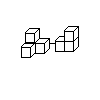
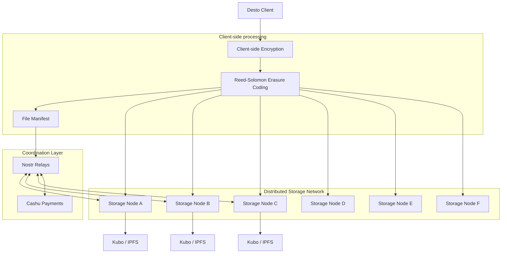
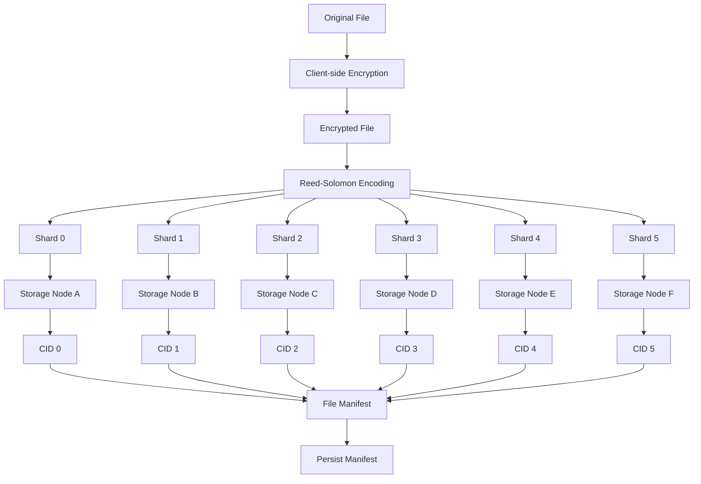
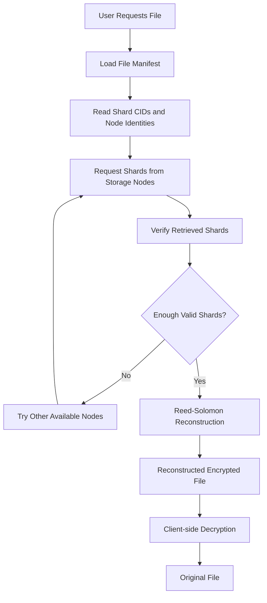

# DESTO

  

  <strong>Decentralized storage. User-owned data. Peer-to-peer payments.</strong>

  An open-source decentralized storage project built around <a href="https://github.com/nostr-protocol">Nostr</a> and <a href="https://cashu.space/">Cashu</a>.

---

> [!WARNING]
> **Work in Progress**
>
> Desto is under active development. The client-side encryption and erasure-coding implementations are working, and the initial storage-node implementation is being developed. Nostr integration, distributed storage coordination, Cashu payments, and storage integrity mechanisms are planned. APIs and architecture are subject to change.

## Overview

Desto promises to provide a decentralized, user-owned file storage through a network of independent storage nodes.

Files are encrypted on the client before being distributed. Erasure coding allows encrypted data to be fragmented into multiple shards, which can be stored across independent nodes and reconstructed when needed even when some of the shards are missing which improves data recovery.

The project uses:

- **Go** — Core client and storage-node implementation.
- **Nostr** — Node identity, discovery, storage coordination and signed agreements.
- **Cashu** — Peer-to-peer payments between storage clients and providers.
- **Kubo / IPFS** — Content-addressed storage and retrieval of individual shards.
- **Reed–Solomon** — Erasure coding for distributed storage and recovery.

## Architecture

### 1. System overview

Each component has a distinct responsibility. Desto handles storage coordination and data management, while external protocols provide discovery, storage infrastructure ( this is still in exploration stage, kubo might help abstract away the storage engine, if not then I'll have to find other alternatives or create my own) and payments.

*Conceptual architecture. Each storage node operates independently and maintains its own storage backend. Cashu payments are coordinated separately from shard storage.*

### 2. File upload and distribution

The client encrypts the original file before applying erasure coding. Each resulting shard is assigned to a storage node.

A manifest tracks the relationship between the original file, its shards, their indexes, CIDs and storage-node identities.

For example, a `4+2` Reed–Solomon configuration produces six shards. Any four valid shards are sufficient to reconstruct the encrypted file, assuming the chosen coding scheme and shard parameters.

### 3. File retrieval and reconstruction

The client uses the file manifest to locate the shards and map it to a certain file. It does not need every storage node to be online: it retrieves the minimum number of valid shards required for reconstruction which is n from (n+m) shards where m is the number of parity shards and n is the number of data shards. The order of shards is important

The client verifies shard integrity before reconstruction through the reed solomon package and performs decryption locally. Missing shards can eventually be regenerated and placed on other nodes after reconstruction.

## Core Design

| Component | Responsibility |
|---|---|
| Client-side encryption | Encrypt files before they leave the user's device |
| Reed–Solomon | Generate redundant shards for fault tolerance |
| File manifest | Map file IDs to shard indexes, CIDs and storage nodes |
| Storage nodes | Accept and persist encrypted shards |
| Kubo / IPFS | Content-addressed storage and retrieval |
| Nostr | Node discovery, identity and storage coordination |
| Cashu | Payments for storage services |
| Integrity verification | Verify shard contents and eventually prove continued possession |
| Recovery | Reconstruct missing shards and restore redundancy |

## Development Status

### Core storage

- [x] Client-side encryption implementation.
- [x] Envelope encryption with separate data-encryption and key-encryption keys.
- [x] Initial TCP-based storage-node implementation.
- [x] Reed–Solomon erasure-coding implementation.
- [ ] Refactor communication between client and node by using gRPC.
- [ ] Refine client upload and retrieval workflows.
- [ ] Implement file manifest and shard metadata management.
- [ ] Integrate Kubo as the storage backend.
- [ ] Implement persistent storage-node metadata.

### Decentralization and coordination

- [ ] Register storage nodes on Nostr.
- [ ] Implement Nostr-based node identity.
- [ ] Register clients using Nostr identities.
- [ ] Implement storage-node discovery from the client.
- [ ] Implement storage offers and agreements.
- [ ] Implement client-side storage scheduling and node selection.
- [ ] Implement file distribution across independent nodes.

### Security and reliability

- [ ] Implement key lifecycle management and recovery.
- [ ] Implement shard integrity verification.
- [ ] Evaluate Merkle trees for integrity proofs.
- [ ] Implement node availability monitoring.
- [ ] Implement node failure recovery and shard repair.
- [ ] Design storage persistence and retention mechanisms.
- [ ] Evaluate proof-of-storage mechanisms ( refer to filecoin's POS ).
- [ ] Design incentives and penalties for storage providers.

### Payments

- [ ] Integrate Cashu.
- [ ] Implement storage pricing and payment schedules along with penalties.
- [ ] Implement payment verification and storage agreement settlement.

## Design Considerations

Some areas are still being explored and are not yet finalized:

- **Storage persistence:** How to incentivize nodes to retain data for agreed periods.
- **Proof of storage:** How clients can verify that a node continues to possess the data it accepted.
- **Node failure recovery:** How to restore redundancy when storage nodes become unavailable.
- **Key management:** How users can securely persist and recover encryption keys.
- **Decentralized coordination:** How to use Nostr without making relays a single point of failure.
- **Storage integrity:** Evaluating Merkle trees and other verification mechanisms for making sure the provider stores the data with integrity.
- **General payment based on data size and the number of days being stored**

## Project Goals

Desto is platform of decentralized storage built around user ownership, privacy and independent storage providers.

The long term goal is to build a platform where users can store encrypted data across independent nodes, retain control of their encryption keys, and compensate storage providers directly without any mediary with secure payments and also allow storage providers ( you guys ) to provide storage in return for compensation.

## Contributing

Desto is an early stage open-source project. Contributions, architectural discussions and feedback are welcome. Please create an issue or message me personally about proposed changes before submitting larger contributions.

---

**Status:**  Work in Progress